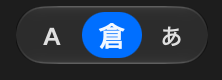

<div align="center">
  
  <h1>Yahoo! KeyKey 2 — 倉頡調整版</h1>
  <p><strong>Yahoo! KeyKey 2 的分支：調整倉頡的選字，並改用範本模式圖示</strong></p>
</div>

本分支建立在 **Teddy Chan** 的 [teddychan/yahoo-keykey-2-macos](https://github.com/teddychan/yahoo-keykey-2-macos) 之上，從上游 **v2.20.1** 開始。應用程式、四種輸入法（倉頡、速成、注音、拼音）和工具都屬於那個專案；出處見上游的 [README](https://github.com/teddychan/yahoo-keykey-2-macos#readme) 與 [CREDITS.md](https://github.com/teddychan/yahoo-keykey-2-macos/blob/main/CREDITS.md)。下面只寫本分支不一樣的地方。

[](https://github.com/teddychan/yahoo-keykey-2-macos)


[](LICENSE)

## 這個分支改了什麼

### 倉頡選字

只有**倉頡**改變。速成、注音和拼音的空白鍵仍與上游相同。

- **五代可以用 `戈土心` 打出「應」。** `igp` 加進 `Resources/cangjie.txt`。五代原本的 `戈人土心` 仍然有效，三代本來就有 `戈土心`。
- **空白鍵打開候選，而不是直接送出第一個字。** 一個碼有多個完全符合的字時——`大月` 有 有 和 冇——第一次按空白鍵只顯示清單。`1–9` 選字；再按一次空白鍵或 Return 接受第一個；其他可列印字元會先接受第一個，再照常處理。只有一個完全符合的字時，第一次按空白鍵仍然直接送出。空白鍵之前再打的字根仍會加長這個碼。
- **空白鍵不再用來翻倉頡的候選頁。** 請用方向鍵或 Page Up／Page Down。速成和注音的空白鍵仍然翻頁。
- **候選順序預設固定。** **依選字習慣調整候選字順序** 現在預設關閉，所以用 `2` 選了冇，下次不會排到有的前面。這是全域設定，因此速成、注音、拼音和聯想字詞也維持內建順序。到 **設定… ▸ 一般** 打開，就恢復上游的學習；已經記下來的次數會保留。

邏輯在 `App/InputController.swift`、`App/KeyEventPolicy.swift`，預設值在 `App/Preferences.swift`。細節見 [docs/handoff-cangjie-result-logic.md](docs/handoff-cangjie-result-logic.md)。

### 圖示

倉頡的模式圖示是一張灰階加透明的倉字（`App/CangjieGlyphTemplate.tiff`）。macOS 著色的方式和 ABC 的「A」、日文的「あ」一樣：淺色切換列是黑字，深色切換列是白字，藍色選取圓是白字，深色選單列也是白字。速成、注音和拼音仍用白底上的全彩紫色 Y（`App/YahooKeyKey.tiff`）。原因見 [docs/adr/0001-cangjie-mode-template-icon.md](docs/adr/0001-cangjie-mode-template-icon.md)。

深色選單列上的白色倉，以及輸入選單裡的同一個字：


游標旁的切換列裡，藍色選取圓上的白色倉，旁邊是 ABC 的 A 和日文的あ：



`./tools/run-debug.sh` 安裝的除錯版，模式名稱仍是倉頡／速成／注音／拼音，沒有「(Debug)」。

> [!IMPORTANT]
> 本分支不發布版本，也沒有自己的更新來源。上游的下載、Homebrew cask 和 **檢查更新…** 裝的都是上游版本，不含上面的改動。要用本分支，請依下面的步驟從原始碼建置。

## 建置與安裝

需要 **macOS 26**、**Apple 晶片**，以及 **Xcode 26 工具鏈**。`./tools/build-lm.sh` 只需要跑一次。

```sh
git clone https://github.com/machingclee/yahoo-keykey-2-macos-cangjie-adjusted.git
cd yahoo-keykey-2-macos-cangjie-adjusted
./tools/build-lm.sh
./tools/build-app.sh
mkdir -p ~/Library/Input\ Methods
cp -R build/YahooKeyKey2.app ~/Library/Input\ Methods/
```

1. **登出再登入。** macOS 只在登入時尋找新的輸入法。
2. **系統設定 ▸ 鍵盤**，在 **輸入來源** 旁按 **編輯…**，**+ ▸ 繁體中文** → **倉頡**、**速成**、**注音** 及／或 **拼音**。
3. 按 **⌃Space** 切換後開始打字。

若不想蓋掉已經安裝的正式版，執行 `./tools/run-debug.sh`。它會安裝並啟動 `~/Library/Input Methods/Yahoo KeyKey 2 Debug.app`，這是另一個輸入法。模式名稱維持中文。

重新建置後，替換當初安裝的那個 app，再登出登入。不要用 **檢查更新…**，也不要把本分支裝到上游 Homebrew cask 的位置上：兩者的 bundle id 相同。

功能、各種輸入法的打法、疑難排解、測試與授權，見上游的 [README](https://github.com/teddychan/yahoo-keykey-2-macos#readme)。
