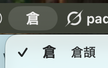

<div align="center">
  
  <h1>Yahoo! KeyKey 2 — 倉頡 adjusted</h1>
  <p><strong>A fork of Yahoo! KeyKey 2 with adjusted Cangjie (倉頡) result logic and a template mode icon</strong></p>
</div>

This fork is built on the previous work of **Teddy Chan**
([teddychan/yahoo-keykey-2-macos](https://github.com/teddychan/yahoo-keykey-2-macos)): the
independent, open-source Swift rebuild of the classic **Yahoo! KeyKey (Yahoo!奇摩輸入法)**
Traditional-Chinese input method for macOS. All credit for the app, its four input methods —
**倉頡** (Cangjie), **速成** (Simplex), **注音** (Zhuyin, ㄅ半) and **拼音** (Pinyin) — and its
tooling goes to that project, which in turn credits the original Yahoo! KeyKey and its data
sources; see [CREDITS.md](CREDITS.md). This fork starts from upstream **v2.20.1**, and the fork's
author only adjusted the **倉頡**-related logic and display described under
[What this fork changes](#what-this-fork-changes) (the one setting that reaches past 倉頡 is
noted there). Everything else behaves as upstream does.

[](https://github.com/teddychan/yahoo-keykey-2-macos)


[](LICENSE)

## What this fork changes

### 倉頡 result logic

Only **倉頡** is affected; 速成, 注音 and 拼音 keep their upstream Space behaviour.

- **`戈土心` types 應 in 五代.** `igp` is added to `Resources/cangjie.txt`. The classical 五代 code
  `戈人土心` still works, and 三代 already had `戈土心`.
- **Space opens the choices instead of committing the first result.** When a code has more than
  one *exact* match — `大月` gives 有 and 冇 — the first Space shows the list and commits nothing.
  Then `1–9` picks; Space again or Return accepts the first; any other printable character accepts
  the first and is then processed normally (a letter starts the next code, punctuation follows the
  committed character). A code with a single exact match still commits on the first Space, even
  with **顯示字根開頭相同的字** on. A radical typed *before* Space still extends the code.
- **Space no longer pages the 倉頡 list.** Use the arrow keys or Page Up / Page Down. Space still
  pages in 速成 and 注音.
- **Candidate order is stable by default.** **依選字習慣調整候選字順序** is now off out of the box,
  so picking 冇 with `2` does not move it above 有 next time. It is one global setting, so 速成,
  注音, 拼音 and 聯想字詞 also keep their built-in order. Turn it on in **設定… ▸ 一般** to get
  upstream's learning back; counts already saved are kept and used again.

The logic lives in `App/InputController.swift` and `App/KeyEventPolicy.swift`
(`cangjieSpaceAction`, `isCandidateAcceptCharacter`), with the default in `App/Preferences.swift`.
Details and the manual test sequence are in
[docs/handoff-cangjie-result-logic.md](docs/handoff-cangjie-result-logic.md).

### Icon and display

- **The 倉頡 mode icon is a template.** It is a single gray-and-alpha 倉 glyph
  (`App/CangjieGlyphTemplate.tiff`, drawn by `tools/render-cangjie-icons.swift`) that macOS
  tints the way it does for ABC's "A" and Japanese "あ": black on the light input switcher, white
  on the dark switcher, white on the blue selection and white on a dark menu bar. 速成, 注音 and
  拼音 keep the full-colour purple Y on its white tile (`App/YahooKeyKey.tiff`). The reasons and
  the Info.plist keys involved are in
  [docs/adr/0001-cangjie-mode-template-icon.md](docs/adr/0001-cangjie-mode-template-icon.md) and
  [docs/handoff-cangjie-icon.md](docs/handoff-cangjie-icon.md).

  White 倉 on a dark menu bar, and the same glyph in the input menu:

  

  White 倉 on the blue selection in the inline switcher, beside ABC’s A and Japanese あ:

  

- **Input-method icon.** `App/Info.plist` now names `YahooKeyKey.tiff` as the input method's own
  icon (`tsInputMethodIconFileKey`).
- **Debug builds keep plain mode names.** `./tools/run-debug.sh` still installs a separate
  `.debug` input method, but its modes are listed as 倉頡 / 速成 / 注音 / 拼音 with no
  "(Debug)" suffix.
- `tools/make-icon.sh` and `tools/build-app.sh` generate and bundle the new glyph.

> [!IMPORTANT]
> This fork does not publish releases or its own update feed. The upstream download, Homebrew cask
> and **檢查更新…** all deliver **upstream** builds, which do not include the changes above — and
> checking for updates in a build of this fork would replace it with upstream's. To use the fork,
> [build it from source](#building-from-source) and install the resulting app as described under
> [Install](#install).

## Contents

- [What this fork changes](#what-this-fork-changes)
- [Requirements](#requirements)
- [Install](#install)
- [Features](#features)
- [Input methods](#input-methods)
- [Troubleshooting](#troubleshooting)
- [Building from source](#building-from-source)
- [Tests](#tests)
- [Contributing](#contributing)
- [Credits](#credits)
- [License](#license)

## Requirements

- **macOS 26 Tahoe** or later
- A Mac with **Apple Silicon** — there is no Intel version
- To build this fork: the **Xcode 26 toolchain** (see [Building from source](#building-from-source)).
  A local build is ad-hoc signed, not notarized.

## Install

> [!IMPORTANT]
> **Log out and back in after installing.** macOS only looks for new input methods when you log
> in — this is the most common reason KeyKey seems not to work.

1. [Build the app](#building-from-source) to get `build/YahooKeyKey2.app`.
2. Move `YahooKeyKey2.app` into `~/Library/Input Methods/` — create the folder if it is not
   there. (For quick testing, `./tools/run-debug.sh` installs a separate **Yahoo! KeyKey 2 Debug**
   input method instead.)
3. **Log out and back in.**
4. Add the input source: **System Settings ▸ Keyboard**, then **Edit…** beside **Input Sources**
   (the `+` is inside that sheet, not on the settings page), **+ ▸ Chinese, Traditional** →
   **倉頡**, **速成**, **注音** and/or **拼音**.
5. Press **⌃Space** to switch to Yahoo! KeyKey 2 and start typing. In **倉頡**, Space shows the
   choices when a code has several characters (`1–9` picks), or commits when it has one; typing
   another character takes the first candidate and carries on. The arrow keys page through the
   list.
6. **Optional:** open **設定… ▸ 一般** and choose **為所有使用者安裝…** (*Install for All
   Users…*). After asking for an administrator password it moves itself to
   `/Library/Input Methods`, so it keeps working when another app, such as 1Password, turns on
   secure input — see [known issue #2](known_issues.md#2-倉頡-is-greyed-out-and-will-not-turn-on).

Not showing up? See
[known issues](known_issues.md#1-yahoo-keykey-2-does-not-show-up-after-installing).

### Update

Rebuild from this checkout and replace the app in the folder you installed it to, then log out
and back in. Do not use **檢查更新…** (it follows upstream's appcast and installs an upstream
build), and do not install this fork over the upstream Homebrew cask: both use the same bundle id.

### Uninstall

1. **Remove the input source first:** **System Settings ▸ Keyboard ▸ Input Sources**, select
   Yahoo! KeyKey 2 and remove it. The app's own Uninstall pane cannot do this part for you.
2. **Then remove the app** — Homebrew (if you installed upstream's cask):
   `brew uninstall --cask teddychan/tap/yahoo-keykey-2`. Otherwise, for a copy in
   `~/Library/Input Methods`, open **設定… ▸ 解除安裝** or drag
   `~/Library/Input Methods/YahooKeyKey2.app` to the Trash. Installed for all users, drag
   `/Library/Input Methods/YahooKeyKey2.app` to the Trash in Finder, which asks for an
   administrator password. **解除安裝** cannot remove such a copy: it stops before removing
   anything and tells you the same.
3. **Log out and back in.**

The **解除安裝** pane also clears your settings, learning data and cache. If you deleted the app
by hand — which is the only way for a copy installed for all users — and want those gone too:

```sh
rm -rf ~/Library/Application\ Support/YahooKeyKey2
rm -f  ~/Library/Preferences/com.dragonapp.inputmethod.yahoo-keykey.plist
rm -rf ~/Library/Caches/com.dragonapp.inputmethod.yahoo-keykey
rm -rf ~/Library/HTTPStorages/com.dragonapp.inputmethod.yahoo-keykey
```

## Features

- **Four input methods** — add the ones you use under Input Sources and switch with ⌃Space.
  See [Input methods](#input-methods) for how each one types.
  - **倉頡 (Cangjie)** — the classic radical method, with `*` as a wildcard for when you cannot
    remember every radical.
  - **速成 (Simplex)** — 倉頡's shorthand: just the first and last radical.
  - **注音 (Zhuyin)** — the classic phonetic method, one character at a time (ㄅ半). 標準 (大千),
    倚天 and 許氏 (Hsu) keyboards. **智慧選字** types a whole sentence and lets the language model
    pick the characters; it is off until you turn it on.
  - **拼音 (Pinyin)** — builds whole phrases from pinyin without tones.
- **Candidates that stay put, unless you ask** — the list keeps its built-in order by default, so
  picking a candidate never reshuffles it. Turn **依選字習慣調整候選字順序** on in Settings if you
  want the characters you pick to move up, in all four input methods and 聯想字詞 alike.
- **Associated words (聯想字詞)** — after you commit a character, KeyKey suggests the words that
  usually follow, pickable with `1–9` or `Shift + 1–9`.
- **繁 → 簡 and full-width punctuation** — toggle both straight from the input menu.
- **Candidate window that follows your cursor** — never clipped off-screen, paged with the arrow
  keys or Page Up / Page Down (Space also pages in 速成 and 注音), at whatever size you set.
- **See the code (反查／拆碼提示)** — show each candidate's 倉頡 code, or its pinyin reading — so
  in 注音 you can look up how to type the same character in 倉頡.
- **臨時英數** — hold **Shift** and press a letter to type that one English letter without
  switching input source.
- **字根開頭相同的字** — turn on **顯示字根開頭相同的字** in Settings and typing 竹 in 倉頡 or
  速成 also offers 我 (竹手戈), as `竹*` would. The characters whose code is exactly what you
  typed stay first.
- **全形空白** — turn on **Shift + 空白鍵輸入全形空白** in Settings and **Shift + Space** types a
  full-width space (　) in all four input methods.
- **Backup and restore** — save your settings to a folder from **設定…** and bring them back
  later, handy when setting up a new Mac.
- **Free and open source** — MIT licensed, signed and notarized, with in-app updates.

> [!NOTE]
> Yahoo! KeyKey 2 is not affiliated with, or endorsed by, Yahoo. It is an independent project
> that exists to honor the original work and keep a KeyKey-style experience alive on modern
> macOS.

## Input methods

Yahoo! KeyKey 2 installs **four input methods**. Each one is a separate entry under **Input
Sources** (Chinese, Traditional), so add only the ones you use and switch between them with
**⌃Space**.

| Input method | How you type | Its own setting (設定… ▸ 輸入方式) |
|---|---|---|
| **倉頡** (Cangjie) | 倉頡 radicals on the letter keys; `*` is a wildcard | **倉頡版本** — 五代 or 三代 |
| **速成** (Simplex) | the first and last radical of a character's 倉頡 code | follows **倉頡版本** |
| **注音** (Zhuyin) | 注音 symbols, then a tone — one character at a time (ㄅ半), or a whole sentence when **智慧選字** is on | **注音鍵盤** — 大千, 倚天 or 許氏 · **智慧選字** (off by default) |
| **拼音** (Pinyin) | pinyin without tones — whole phrases at once | — |

繁 → 簡, full-width punctuation, 反查提示 and **依選字習慣調整候選字順序** apply to all four.

### 倉頡 and 速成: 倉頡版本

Choose the decomposition table in **設定… ▸ 輸入方式**. It drives both 倉頡 and 速成, and applies
immediately.

| Mode | Based on | Candidate order | Example codes |
|---|---|---|---|
| **五代倉頡** (default) | ibus `cangjie5` | corpus frequency | 面 `一田尸中`, 鬼 `竹山戈` |
| **三代倉頡** (Yahoo! KeyKey compatible) | original Yahoo! KeyKey tables | Yahoo's original order | 面 `一田卜中`, 鬼 `竹戈` |

Yahoo! KeyKey 2 also accepts `戈土心` for 應 in 五代 (its classical 五代 code is `戈人土心`,
which still works). 三代 already spelled it `戈土心`.

When a 倉頡 code matches more than one character — `大月` gives 有 and 冇 — the first Space
**opens the candidate list and waits**. Press `1–9` to pick (press `2` for 冇), or type any other
character: 有 is committed and that character is then processed normally. A letter starts the
next character, a punctuation mark is inserted after 有, and a second Space simply accepts 有.
Return accepts 有 too. A code with only one matching character commits on Space directly.
The list keeps its built-in order: picking 冇 with `2` does not move it to the top. If you want
that learning behaviour, turn **依選字習慣調整候選字順序** on in Settings.

**五代** is the default, so existing users are unaffected until they opt in. Both orders are
fixed, and in 倉頡/速成 each is the tie-breaker rather than a score the learning layer adjusts:
**依選字習慣調整候選字順序** is off by default, so every list keeps the order above. Turn it on
and each candidate list is ordered by how often you have committed each candidate *in that list*,
with the table order deciding between candidates you have committed equally often. Turning it off
again shows the table order alone — so 三代 with learning off is the original Yahoo! KeyKey order
and nothing else. Usage is counted per candidate list, so a 倉頡 code, a 倉頡 wildcard pattern and
a 速成 code each learn separately, while 倉頡 and 速成 share what they learn about 聯想字詞. 拼音
is outside that scheme: it ranks candidates as it always has, and the same setting turns its
learning on and off.

Yahoo! KeyKey's *associated-phrase* ranking cannot be reproduced — that data was never
open-sourced — so associations use Yahoo! KeyKey 2's own ordering in both modes.

### 注音 (ㄅ半)

The **ㄅ半** method, as it has always worked: one syllable, one character. Type the 注音 symbols,
finish the syllable with a tone, and the candidate window opens — unless the reading has only one
character, which is typed straight away. `1–9` picks, Space and the arrow keys page, and typing the
next character's first symbol commits the one on screen so you can run on without pressing Enter.
聯想字詞 follows every commit, exactly as in 倉頡 and 速成.

| | |
|---|---|
| **First tone** | **Space** — the one tone with no key of its own |
| **Other tones** | 大千 `6` ˊ · `3` ˇ · `4` ˋ · `7` ˙  ·  倚天 `2` ˊ · `3` ˇ · `4` ˋ · `1` ˙  ·  許氏 `d` ˊ · `f` ˇ · `j` ˋ · `s` ˙ |
| **Pick a candidate** | `1–9` (a number with no candidate on its row types 注音 instead) · **Return** takes the first on the page · Space pages (and takes the first when there is only one page) |
| **Fix a wrong tone** | **Backspace** removes the tone and leaves the symbols |
| **聯想字詞** | **Shift + 1–9** (a bare number types 注音, so it cannot also pick) |
| **，。** | On 大千 and 倚天, **Shift + `,`** and **Shift + `.`** — `,` and `.` themselves type ㄝ and ㄡ. On 許氏 those keys stay punctuation |

Choose the keyboard in **設定… ▸ 輸入方式 ▸ 注音鍵盤**, or straight from the input menu while 注音
is active. **標準（大千）** is the default: the layout printed on Taiwanese keyboards, and the one
the original Yahoo! KeyKey shipped. **倚天** puts the symbols on the letters that spell them.
**許氏** puts two or three symbols on a key and reads them from the keys around it — see
[許氏 (Hsu)](#許氏-hsu). The other 26-key layouts (倚天 26 鍵, IBM) are not offered.

Candidates come from the original Yahoo! KeyKey ㄅ半 table (`bpmf-ext.cin`), in its own order —
the everyday character for a reading leads it, and there is no dictionary re-ranking on top. What
you pick is then learned per reading, the same way 倉頡 learns per code.

### 許氏 (Hsu)

**許氏** is the 26-letter 注音 keyboard: one key stands for several symbols (`m` is ㄇ or ㄢ, `j` is
ㄐ, ㄓ or the fourth tone) and the symbol is decided by the keys around it. Space is the first tone;
the other tones are `d` ˊ · `f` ˇ · `j` ˋ · `s` ˙. With 智慧選字 off (the default) it still types one
character at a time, the same ㄅ半 as 大千 and 倚天 — `nef` is ㄋㄧˇ (你), `hwf` is ㄏㄠˇ (好). The number keys and the punctuation
keys are not 注音 keys here, so `1–9` pick a candidate directly and ， and 。 stay on `,` and `.`.
The reading rules are a port of McBopomofo's Hsu table (`Mandarin.h` / `Mandarin.cpp`, MIT).

### 智慧選字

**智慧選字** is off by default, in 設定… ▸ 一般 and in the input menu while 注音 is active. Turn it
on and a tone ends each syllable, so you can type a whole sentence — on 許氏, `jen tem tem vej hnf
hwf` (Space is the first tone) becomes 今天天氣很好 — and the language model chooses the characters.
It works on 大千, 倚天 and 許氏. ← → move one character at a time (the one under the cursor is
underlined). The list offers the word the model chose, then every single character for that
syllable, then longer words, so one character of a word can be changed on its own (太長 → 太常).
`1–9` swaps it for another candidate, and Space or Return commits the sentence. Characters you
pick or accept are remembered and lead next time. A syllable without a tone stays as 注音. On 大千
and 倚天 the number keys are 注音 keys, so candidates there are picked with the arrows and Space
instead. Off, 注音 stays the one-character-at-a-time ㄅ半.

### 拼音 (Pinyin)

Type pinyin without tones and 拼音 builds the whole phrase; `'` splits an ambiguous spot, so
`xi'an` gives 西安. The arrow keys move between syllables, `1–9` picks the candidate for the
syllable under the cursor and moves on to the next, and Space or Return commits the whole phrase.

## Troubleshooting

Common problems, and what each one turns out to be, are collected in
**[known_issues.md](known_issues.md)**:

| Problem | |
|---|---|
| It does not show up after installing | [#1](known_issues.md#1-yahoo-keykey-2-does-not-show-up-after-installing) |
| 倉頡 is greyed out and will not turn on | [#2](known_issues.md#2-倉頡-is-greyed-out-and-will-not-turn-on) |
| A character's code is not what you expect | [#3](known_issues.md#3-a-characters-code-is-not-what-i-expect) |
| Space pages instead of accepting your code | [#4](known_issues.md#4-space-pages-instead-of-accepting-my-code) |
| Typing a number inserts a word | [#5](known_issues.md#5-typing-a-number-inserts-a-word-instead) |
| In 注音, `,` and `.` type ㄝ and ㄡ | [#6](known_issues.md#6-in-注音-the-comma-and-period-keys-type-ㄝ-and-ㄡ) |
| In 注音, a tone key picks a candidate | [#7](known_issues.md#7-in-注音-my-tone-key-picks-a-candidate) |

That file also lists what has **[already been fixed](known_issues.md#8-already-fixed-in-earlier-versions)**,
so check your version before reporting a bug. Anything else —
[open an issue](https://github.com/machingclee/yahoo-keykey-2-macos-cangjie-adjusted/issues)
(or upstream's [tracker](https://github.com/teddychan/yahoo-keykey-2-macos/issues) if it is not specific to this fork).

## Building from source

There is no Xcode project: the app is assembled by shell scripts around `swiftc`, and the test
suites are SwiftPM packages. Requires the **Xcode 26 toolchain** on Apple Silicon.

```sh
git clone https://github.com/machingclee/yahoo-keykey-2-macos-cangjie-adjusted.git
cd yahoo-keykey-2-macos-cangjie-adjusted
./tools/build-lm.sh    # build the language model into Resources/data.txt (first time only)
./tools/build-app.sh   # assemble + ad-hoc sign build/YahooKeyKey2.app
```

For hands-on testing, `./tools/run-debug.sh` builds and installs a separate
**Yahoo! KeyKey 2 Debug** input method with its own bundle id, so it never collides with an
installed release copy. It reports the **target version** — the release being developed toward —
so a fix for 2.13.0 builds as `v2.13.1 Debug` and no modified code ever wears a released number.
See [Versioning convention](docs/RELEASE.md#versioning-convention). Signed release builds come
from [`.github/workflows/release.yml`](.github/workflows/release.yml) on a `v*` tag — see
[docs/RELEASE.md](docs/RELEASE.md).

## Tests

The suite spans two SwiftPM packages. **KeyKeyEngine** covers the 倉頡 and 速成 tables (both 五代
and 三代), code lookup and wildcard matching, frequency ranking and the adaptive walker,
associated phrases (聯想字詞), 注音 keyboards / syllable building / the ㄅ半 table, 拼音
segmentation, and 繁 → 簡 conversion. **KeyKeyApp** covers preferences, key-event policy, and
input-engine conformance across all four modes. CI runs both
on every push and pull request to `main`.

[](https://github.com/teddychan/yahoo-keykey-2-macos/actions/workflows/tests.yml)

```bash
swift test --package-path Packages/KeyKeyEngine
swift test --package-path Packages/KeyKeyApp
```

| Metric | Value |
|---|---|
| Test cases | 459 passing (334 engine, 125 app) |
| Line coverage | 97.8% of `KeyKeyEngine`, 95.8% of `KeyKeyApp` |
| Measured on | v2.16.0, Swift 6.4 |

One further engine test (`RealPinyinWalkerTests`) skips itself unless `Resources/data.txt` has
been generated by `./tools/build-lm.sh`. Coverage is measured with `--enable-code-coverage` over
each package's own `Sources/`, excluding the test files themselves and the vendored DragonKit
dependency.

## Contributing

Bug reports and pull requests are welcome on the
[issue tracker](https://github.com/machingclee/yahoo-keykey-2-macos-cangjie-adjusted/issues). Before opening a pull
request, run both test suites (see [Building from source](#building-from-source)) and add a
plain-language entry to [CHANGELOG.md](CHANGELOG.md) describing the user-visible change.
Release mechanics are documented in [docs/RELEASE.md](docs/RELEASE.md).

## Credits

Yahoo! KeyKey 2 is built in tribute to the original **Yahoo! KeyKey (Yahoo!奇摩輸入法)**.
See [CREDITS.md](CREDITS.md) for the original projects, data sources, and engine
attributions, and [docs/THIRD-PARTY-NOTICES.md](docs/THIRD-PARTY-NOTICES.md) for full
third-party license details.

## License

Yahoo! KeyKey 2 is released under the [MIT License](LICENSE). Bundled third-party data keeps
its own permissive license — see [docs/THIRD-PARTY-NOTICES.md](docs/THIRD-PARTY-NOTICES.md).
